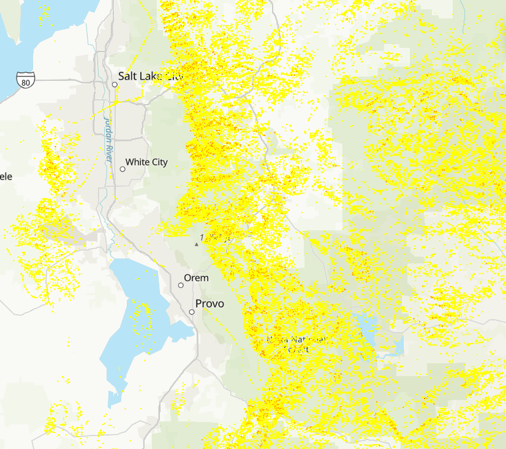

# <ins> Utah Wildfire Risk Final Project </ins>

## Overview
This project maps which areas of Utah are more susceptible to wildfire,
using ArcGIS Pro. Risk was assessed through several factors, including
slope, proximity to urban areas, and landcover.

## Methods
- Each dataset was converted into a "binary layer" showing which areas
  were safe and which were not.
- The binary layers were then combined to show which areas of Utah are
  most susceptible to wildfires.

## Project links
- [Project files and data](https://usu.box.com/s/xvtkfe6877lciib12wvgbo6wtb3ic65d)
- [Original StoryMap](https://storymaps.arcgis.com/stories/9507738b6dc24f0f8cc2a72f3fec541d)
